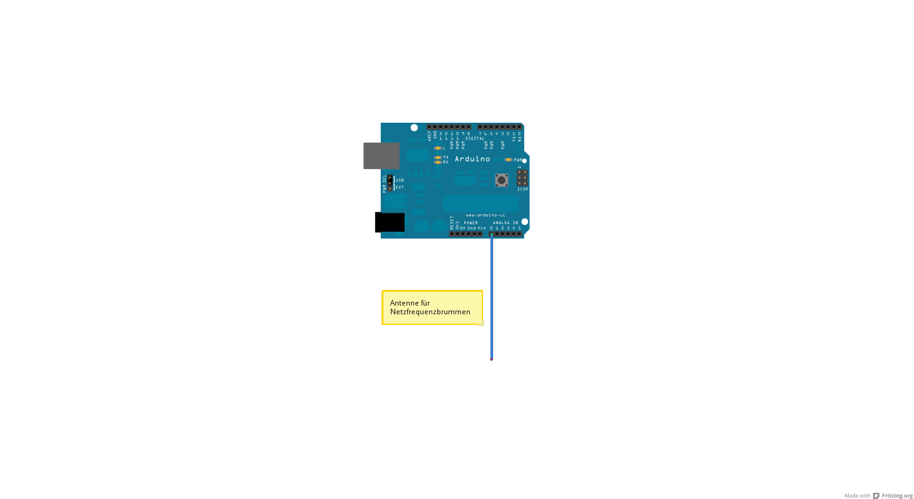

# Bestimmung der Netzfrequenz mittels Arduino

🇬🇧 [English version](README.md)

Dieser kleine Sketch zeigt, wie man mittels einer einfachen kurzen Antenne
an einem Analog-Port des Arduinos die aktuelle Netzfrequenz des Stromnetzes
messen kann.

Die Messung der Netzfrequenz kann interessant sein, um zu beobachten, ob momentan genug
oder zu wenig Strom ins Netz eingespeist wird.
Wird zu wenig Strom eingespeist, so sinkt die Netzfrequenz.
Wird zu viel Strom eingespeist, so steigt die Netzfrequenz.

Eine solche Messung könnte im Zusammenhang mit „Smart Grids" besonders interessant werden:
Die Netzfrequenz ist ein direkter Indikator für das Gleichgewicht zwischen Stromerzeugung und -verbrauch im gesamten Netz.
Übersteigt der Verbrauch die Erzeugung, sinkt die Frequenz unter 50 Hz; übersteigt die Erzeugung den Verbrauch, steigt sie über 50 Hz.

Die Kernidee ist, dass **jedes Gerät am Stromnetz den aktuellen Lastzustand selbstständig ermitteln kann** — einfach durch Messung der Netzfrequenz, ohne zentrale Steuerung oder Kommunikationsinfrastruktur.
So könnten beispielsweise Wärmepumpen, Kühlschränke oder Ladestationen autonom entscheiden, sich bei Stromüberschuss (hohe Frequenz) einzuschalten und bei Netzbelastung (niedrige Frequenz) den Betrieb zu verschieben oder auszusetzen.
Das würde ein vollständig dezentrales, sich selbst organisierendes Stromnetz ermöglichen — ganz ohne zentrale Instanz.

Siehe dazu auch: http://www.solarify.eu/2015/01/27/205-smart-grid-einfach-dezentral-selbstorganisiert/

## Programm

An Port A0 wird einfach ein kurzes Stück Draht (beispielsweise 10 cm) angeschlossen.
Das andere Ende des Drahtes wird offen gelassen, so fungiert der Draht als Antenne und
Port A0 „empfängt" dann ein verrauschtes Netzbrummen.

Im Programm wird der zeitliche Abstand der Minimumdurchgänge dieses Brummens gemessen, was
der Periodendauer entspricht.
Aus dem Kehrwert der Periodendauer ergibt sich dann die Frequenz.

Um die Sache etwas genauer zu machen, wird die Zeit für 50 Perioden gemessen und dann
gemittelt.

Die gemessene Frequenz kann dann mit der Frequenz von http://www.netzfrequenzmessung.de/
verglichen werden.

Bei meinen Versuchen hat sich gezeigt, dass es eine Abweichung zwischen der von mir gemessenen
Frequenz und der „offiziellen" Netzfrequenz (von http://www.netzfrequenzmessung.de/) gibt.
Woran diese Abweichung liegt, ist mir momentan noch nicht klar.

Ich kann mir momentan folgende Ursachen hierfür denken:
* Eine Abweichung des Quarzes auf dem Arduino-Board
* Fehlende Interrupts für die Bestimmung der „micros()"; vielleicht durch die A/D-Wandlung

(Falls irgendjemand eine Idee hat, kann er mich gerne über GitHub kontaktieren. Danke.)

## Schaltungsaufbau

Viel Spaß!

ratopi

## Lizenz

Dieses Projekt steht unter der [MIT-Lizenz](LICENSE).

## Voraussetzungen

Dieser Sketch funktioniert mit jedem Arduino- oder ESP-Board, das einen Analogeingang besitzt (z.B. Arduino Uno, Nano, Mega, ESP8266, ESP32).
Man benötigt lediglich ein kurzes Stück Draht (~10 cm) als Antenne — keine weiteren Bauteile erforderlich.

**Hinweis für ESP-Boards:** `analogReference(INTERNAL)` ist auf ESP8266/ESP32 nicht verfügbar. Die ADC-Auflösung und der Spannungsbereich unterscheiden sich von Standard-Arduino-Boards, daher müssen die Schwellwerte (`THRESHOLD_LOW` und `THRESHOLD_HIGH`) gegebenenfalls angepasst werden.

