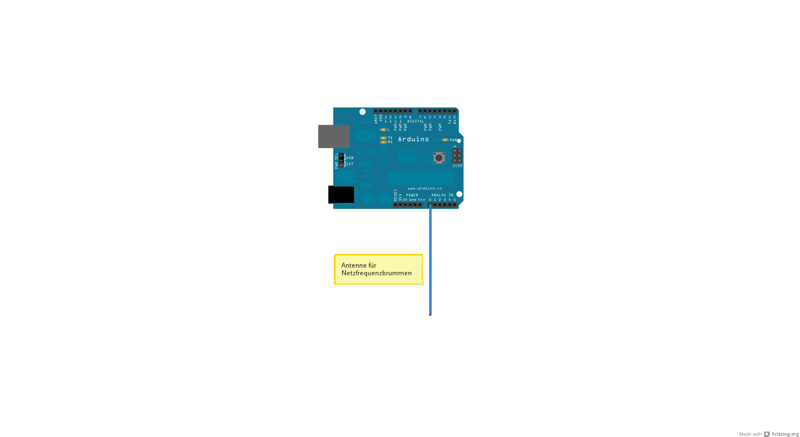

# Determining the Mains Frequency Using an Arduino

🇩🇪 [Deutsche Version](README.de.md)

This small sketch shows how to measure the current mains frequency of the power grid
using a simple short antenna connected to an analog port of the Arduino.

Measuring the mains frequency can be interesting to observe whether enough
or too little power is currently being fed into the grid.
If too little power is fed in, the mains frequency drops.
If too much power is fed in, the mains frequency rises.

Such a measurement could become particularly interesting in the context of "Smart Grids":
The mains frequency is a direct indicator of the balance between power generation and consumption across the entire grid.
If consumption exceeds generation, the frequency drops below 50 Hz; if generation exceeds consumption, it rises above 50 Hz.

The key idea is that **every device connected to the grid can independently determine the current load state** — simply by measuring the mains frequency, without any central control or communication infrastructure.
This means that devices such as heat pumps, refrigerators, or charging stations could autonomously decide to switch on when there is excess power (high frequency) and switch off or postpone operation when the grid is under stress (low frequency).
This would enable a fully decentralized, self-organizing power grid — no central authority needed.

See also: http://www.solarify.eu/2015/01/27/205-smart-grid-einfach-dezentral-selbstorganisiert/

## Program

A short piece of wire (e.g. 10 cm) is simply connected to port A0.
The other end of the wire is left open, so the wire acts as an antenna and
port A0 "receives" a noisy mains hum.

The program measures the time interval between minimum crossings of this hum,
which corresponds to the period duration.
The frequency is then derived from the reciprocal of the period duration.

To improve accuracy, the time for 50 periods is measured and then averaged.

The measured frequency can then be compared with the frequency from http://www.netzfrequenzmessung.de/.

During my experiments, I noticed a deviation between my measured frequency
and the "official" mains frequency (from http://www.netzfrequenzmessung.de/).
The cause of this deviation is currently not clear to me.

I can currently think of the following possible causes:
* A deviation of the crystal on the Arduino board
* Missing interrupts for the determination of "micros()"; possibly caused by the A/D conversion

(If anyone has an idea, feel free to contact me via GitHub. Thanks.)

## Circuit Setup

Have fun!

ratopi

## License

This project is licensed under the [MIT License](LICENSE).

## Requirements

This sketch works with any Arduino or ESP board that has an analog input (e.g. Arduino Uno, Nano, Mega, ESP8266, ESP32).
You only need a short piece of wire (~10 cm) as an antenna — no additional components required.

**Note for ESP boards:** `analogReference(INTERNAL)` is not available on ESP8266/ESP32. The ADC resolution and voltage range differ from standard Arduino boards, so the threshold values (`THRESHOLD_LOW` and `THRESHOLD_HIGH`) may need to be adjusted accordingly.

